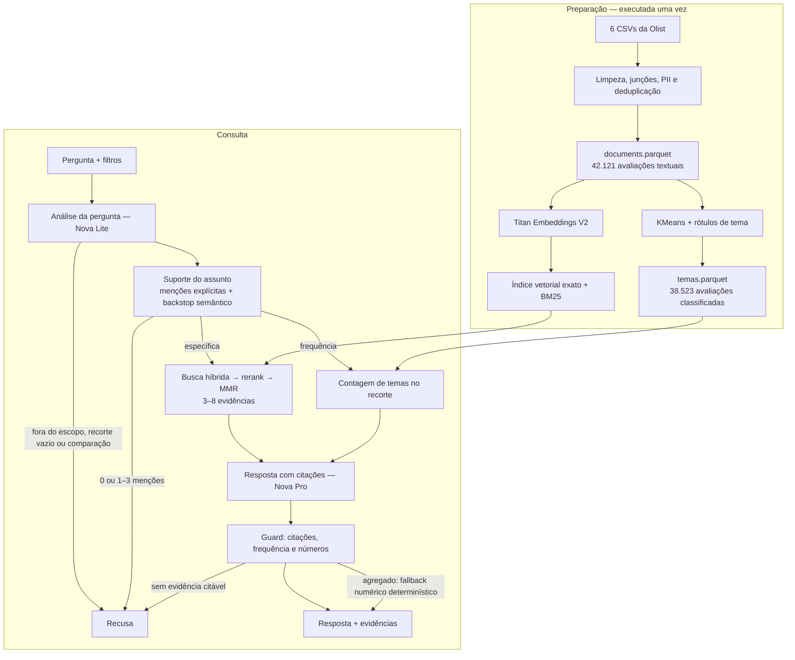
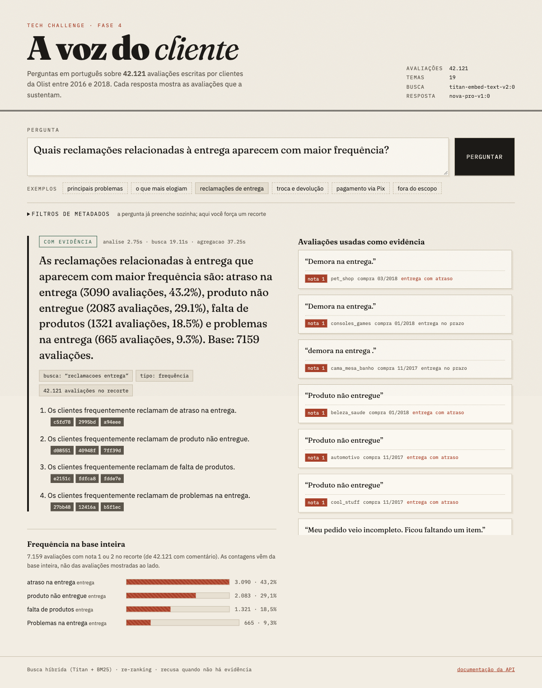
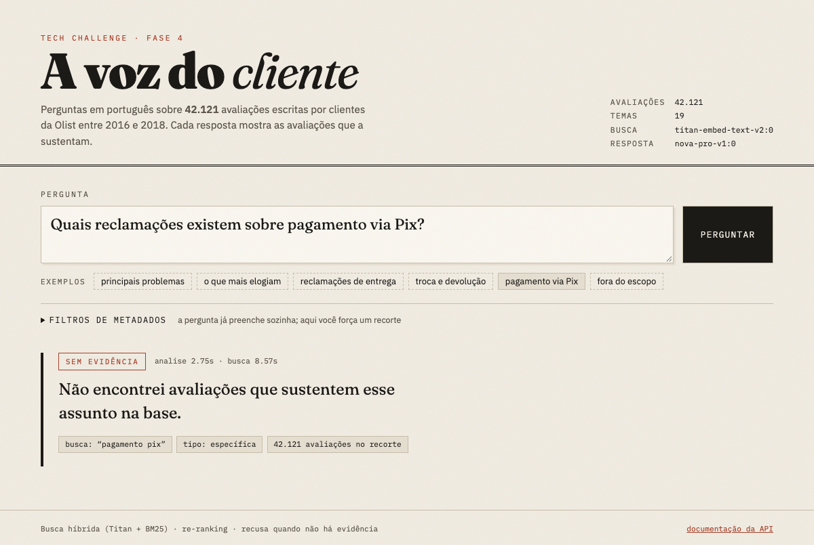

# TECH CHALLENGE FASE 4 — Voice of Customer Intelligence com RAG
**Autor:** Theo Coleone de Camargo
**Curso:** Pós Graduação - AI Scientist - FIAP

Sistema que responde perguntas em português sobre **42.121 avaliações** escritas por clientes de e-commerce, sempre mostrando as avaliações que sustentam a resposta e **recusando responder** quando a base não tem evidência.



---

## 1. Objetivo do projeto

Empresas de e-commerce recebem milhares de avaliações por mês. A nota resume a satisfação, mas o que explica a insatisfação está no texto, que ninguém consegue ler por inteiro. Este projeto transforma esse texto numa base consultável em linguagem natural, com três compromissos:

1. **toda resposta aponta as avaliações que a sustentam**, identificadas por código, para o gestor conferir;
2. **o sistema recusa responder** quando não encontra base, em vez de produzir uma resposta plausível e inventada;
3. **perguntas de frequência** ("quais são os principais problemas?") são respondidas por **contagem sobre todas as avaliações textuais classificadas em temas no recorte**, não pela amostra que a busca devolveu.

O terceiro ponto é o problema técnico central do desafio e está detalhado na [seção 5.6](#56-perguntas-de-frequência-o-limite-do-top-k).

## 1.1 Demonstração navegável

Quem quiser explorar o sistema sem rodar nada pode abrir a **demonstração navegável**: as 44 perguntas do conjunto de avaliação, com as respostas que o sistema realmente produziu, as evidências citadas, as contagens e os casos de recusa.

👉 **[Abrir a demonstração](https://theocoleone.github.io/tech-challenge-4/demo/)**

A página é estática: ela mostra respostas **já geradas** (`docs/demo/respostas.json`, exportado de `eval/results/` por `make demo`) e não chama a AWS. Para fazer perguntas novas, rode o projeto localmente, como descrito na [seção 12](#12-como-reproduzir).

## 2. Problema de negócio

O gestor de uma operação de e-commerce precisa responder perguntas como:

- Quais são os principais motivos de insatisfação dos clientes?
- Quais problemas aparecem com maior frequência?
- O que os consumidores mais valorizam na experiência de compra?
- Quais evidências sustentam determinado insight?

Hoje essas respostas dependem de alguém ler avaliações por amostragem, o que não escala e não é auditável. A solução entrega a resposta em segundos **com as evidências anexadas**, o que permite ao gestor discordar olhando o texto original do cliente.

Um exemplo real do sistema em funcionamento, com a pergunta, a resposta, a contagem e as evidências:



## 3. Base de dados e preparação

### 3.1 Fonte

[Brazilian E-Commerce Public Dataset by Olist](https://www.kaggle.com/datasets/olistbr/brazilian-ecommerce/data), no Kaggle: cerca de 100 mil pedidos feitos entre setembro de 2016 e outubro de 2018, já anonimizados pela própria Olist. Foram usadas 6 das 9 tabelas:

| Tabela | Para que serve |
|---|---|
| `olist_order_reviews_dataset` | **fonte dos documentos**: nota, título e comentário do cliente |
| `olist_orders_dataset` | situação do pedido, data da compra, entrega real e prevista |
| `olist_order_items_dataset` | itens, preço e frete do pedido |
| `olist_products_dataset` | categoria do produto |
| `product_category_name_translation` | tradução da categoria |
| `olist_customers_dataset` | estado do cliente |

Pagamentos, vendedores e geolocalização ficaram de fora: não ajudam a interpretar o texto das avaliações.

### 3.2 Seleção dos dados e tratamento de ausentes

O caminho da base bruta até os documentos de busca está em `notebooks/01_base_conhecimento.ipynb`, que desenvolve cada etapa e depois mostra que o script `src/data/build_documents.py` reproduz o mesmo resultado.

| Etapa | Quantidade |
|---|---|
| avaliações no arquivo original | 99.224 |
| avaliações únicas (um `review_id` por linha) | 98.410 |
| com algum texto (título ou comentário) | 42.370 |
| **com texto útil: entram na busca** | **42.121** |

**57% dos clientes não escrevem nada**, apenas dão a nota. Essas avaliações **não entram no índice de busca nem recebem tema** (não há texto para classificar), mas **continuam na tabela completa** (`reviews.parquet`) para estatísticas de nota e metadados. As contagens temáticas usam somente avaliações com texto útil e nota 1, 2, 4 ou 5. Outras regras:

- **sem título e sem comentário** → fora da busca e da contagem temática, preservada nas estatísticas gerais;
- **só título ou só comentário** → usa o que existe;
- **texto sem conteúdo** (249 casos: "10", "...", "A") → fora da busca;
- **pedido não entregue** → `entregue = False` e `dias_atraso` vazio; nenhuma data é inventada;
- **produto sem categoria** → `sem_categoria`.

### 3.3 Limpeza do texto

Cada avaliação guarda duas versões do texto:

- **`texto_original`**: título e comentário como o cliente escreveu. É o que aparece como evidência, porque a frase do cliente é a prova;
- **`texto_normalizado`**: usado nas buscas. Normaliza Unicode, junta pontuação repetida ("!!!" → "!"), separa a pontuação das palavras e expande abreviações comuns (`vc` → você, `tbm` → também, `n` → não).

De propósito **não** há stemming, **não** há remoção de stop words, **os acentos são mantidos** e **o "não" nunca é removido**: em avaliações, "não chegou" e "chegou" são opostos, e as listas clássicas de stop words incluem o "não". O BM25 tem tokenização própria (minúsculas, sem acento, sem stop words) que **preserva as negações**.

**Dados pessoais:** telefone, CPF, e-mail e CEP são substituídos por marcadores (`[TELEFONE]`, `[CPF]`) **antes** de qualquer arquivo ser gravado, então não entram no índice, no contexto do modelo nem nas respostas. A base pública quase não tem PII (3 telefones e 1 CPF), mas a regra protege o uso real.

### 3.4 Duplicatas

| Caso | Quantidade | Decisão |
|---|---|---|
| mesmo `review_id` em mais de um pedido | 789 | **um documento por avaliação**, com os códigos de pedido concatenados e os metadados do pedido mais recente (`multi_pedido = True`) |
| mesmo pedido com mais de uma avaliação | 547 | mantidas todas: são avaliações distintas |
| textos idênticos ("muito bom", "recomendo") | ~6.000 | mantidos (são clientes diferentes e contam para a frequência), mas **deduplicados na recuperação**, para o top-k não encher de cópias |

### 3.5 Organização dos documentos e dicionário de dados

**Um documento por avaliação, sem chunking.** O p99 das avaliações tem 38 palavras e a maior tem 47, então cada avaliação cabe inteira em um vetor. Quebrar separaria a reclamação do motivo ("chegou quebrado, a embalagem era fina") e faria a citação apontar para um fragmento; juntar várias misturaria clientes diferentes num vetor só. A unidade semântica coincide com a unidade de evidência (`review_id`).

Cada documento carrega 24 campos (`data/processed/documents.parquet`):

| Campo | Tipo | Significado |
|---|---|---|
| `review_id` | texto | código da avaliação; é o que aparece citado nas respostas |
| `order_ids` | texto | código(s) do pedido avaliado, separados por vírgula |
| `review_score` | 1 a 5 | nota dada pelo cliente |
| `texto_original` | texto | título + comentário do cliente, com PII mascarada |
| `texto_normalizado` | texto | versão usada nas buscas |
| `tem_texto`, `tem_titulo`, `tem_mensagem` | booleano | o que a avaliação preencheu |
| `indexavel` | booleano | o texto é útil para busca |
| `n_palavras` | inteiro | palavras do comentário |
| `data_avaliacao` | aaaammdd | quando o cliente respondeu a pesquisa |
| `data_envio_pesquisa` | aaaammdd | quando a pesquisa foi enviada |
| `ano_mes_compra` | aaaamm | mês da compra; é o campo usado nos filtros de período |
| `order_status` | texto | situação do pedido (entregue, cancelado, enviado...) |
| `valor_total` | reais | preço + frete de todos os itens do pedido |
| `multi_pedido` | booleano | a avaliação estava ligada a mais de um pedido |
| `entregue` | booleano | o pedido chegou ao cliente |
| `dias_atraso` | inteiro ou vazio | entrega real menos a prevista (positivo = atraso) |
| `entregue_com_atraso` | booleano | a entrega passou da data prevista |
| `categoria_pt`, `categoria_en` | texto | categoria do item de maior valor do pedido |
| `multi_categoria` | booleano | o pedido tinha produtos de categorias diferentes |
| `n_itens` | inteiro | quantidade de itens do pedido |
| `uf_cliente` | texto | estado do cliente |

Dicionário completo, incluindo os arquivos de temas e avaliação, em [`docs/dicionario_dados.md`](docs/dicionario_dados.md).

Os arquivos são **Parquet** e não CSV: guardam o tipo de cada coluna (uma data não volta como texto), ocupam menos espaço e permitem ler só as colunas necessárias.

### 3.6 O que a análise da base mostrou

Detalhes em `notebooks/02_eda_reviews.ipynb`. Três achados que afetaram o desenho:

1. **Quem comenta é mais o cliente insatisfeito.** 77% dos clientes que deram nota 1 escreveram algo, contra 38% dos que deram nota 5. A nota 1 é 11,5% de todas as avaliações, mas 20,7% dos documentos. A base de busca **super-representa reclamações**; por isso as análises gerais de nota usam `reviews.parquet`, enquanto o RAG declara que suas sínteses temáticas representam apenas quem escreveu texto útil.
2. **Avaliações são curtas**: mediana de 9 palavras. Daí a decisão de não fazer chunking.
3. **Entrega com atraso tem nota média 1,94, contra 4,00 no prazo.** É uma associação observada nos dados, não uma relação de causa, e justifica o atraso como filtro.

## 4. Arquitetura da solução

O diagrama no topo do documento mostra as duas partes.

**Preparação, executada uma vez** (`make data`, `make index`, `make temas`):

1. os CSVs viram uma tabela plana com uma linha por avaliação;
2. cada avaliação vira um vetor de 1.024 dimensões no **Amazon Bedrock (Titan Text Embeddings V2)**, com cache em disco;
3. os vetores vão para um índice de busca exata (NumPy) e o texto para um índice BM25;
4. as 38.523 avaliações textuais com nota 1, 2, 4 ou 5 são agrupadas em **19 temas** para permitir contagem por assunto.

**A cada pergunta** (`make api`):

1. **análise da pergunta** (Nova Lite): escopo, tipo, filtros de metadados e uma busca reescrita;
2. **verificação do assunto explícito**: contagem lexical auditável e, quando necessário, um backstop semântico no top-1;
3. **recuperação híbrida**: busca vetorial + BM25, fundidas por RRF, já com os filtros aplicados;
4. **re-ranking** com cross-encoder e seleção diversa (MMR) → de 3 a 8 avaliações relevantes;
5. **geração** (Nova Pro): resposta estruturada com citações obrigatórias;
6. **validação**: as citações existem? a resposta generaliza indevidamente? os números vieram da contagem?

## 5. O pipeline RAG

### 5.1 Base de conhecimento

Ver [seção 3](#3-base-de-dados-e-preparação). Em resumo: 42.121 documentos, um por avaliação, com 24 metadados cada, embeddings do Titan e índice duplo (vetorial e lexical).

### 5.2 Transformação da pergunta

Uma chamada ao Nova Lite com saída estruturada devolve:

- **escopo**: a pergunta é sobre a experiência de compra ou é outro assunto;
- **tipo**: específica (pede relatos) ou agregada (pede frequência);
- **busca reescrita**: a pergunta vira uma consulta com as palavras que o cliente usaria ("O que relatam sobre atraso?" → "entrega atrasada demorou para chegar");
- **filtros de metadados**: nota, período, categoria, atraso, status do pedido, estado, faixa de valor.

Depois da saída do modelo, regras determinísticas corrigem erros recorrentes encontrados na avaliação:

- **filtro de categoria validado**: a categoria só é aplicada se existir na lista real e se for citada na pergunta (o modelo punha `eletronicos` numa pergunta sobre "drones");
- **assuntos explícitos extraídos da pergunta original**: termos redundantes ao próprio filtro são descartados, para que "pedidos cancelados" seja tratado como recorte, não como um segundo assunto;
- **comparações entre dois recortes são recusadas**: esta versão analisa um recorte por vez e não produz uma comparação unilateral;
- **perguntas sem assunto próprio** ("quais problemas nas avaliações nota 1 de X?") não passam pelo limiar de relevância, porque ali o recorte é dado pelos filtros, e toda avaliação dele é evidência válida.

### 5.3 Recuperação híbrida

A busca vetorial encontra por significado ("demorou demais" responde a uma pergunta sobre atraso); o BM25 encontra por palavra exata, o que importa em termos específicos ("nota fiscal", "voltagem"). As duas listas são fundidas por **Reciprocal Rank Fusion** (`1/(60 + posição)`), que usa só a posição e não exige comparar escalas de score diferentes.

Os **filtros são aplicados antes da busca**, como máscara sobre a tabela, o que garante que o recorte vale para os dois recuperadores.

### 5.4 Seleção das evidências

O **re-ranking** usa um cross-encoder multilíngue (`BAAI/bge-reranker-v2-m3`), que lê pergunta e avaliação juntas e é mais preciso que a comparação de vetores. Depois, o **MMR** escolhe até 8 avaliações equilibrando relevância e diversidade: sem ele o contexto enchia de frases quase idênticas ("Atraso na entrega", "Entrega atrasada") e a resposta ficava rasa. Em perguntas com assunto explícito, um piso de relevância impede o MMR de completar o contexto com itens quase irrelevantes; por isso o modelo recebe de 3 a 8 evidências. Uma segunda busca restrita a avaliações mais longas garante relatos detalhados, e não só frases de três palavras.

### 5.5 Geração com citações

O contexto manda as avaliações em tags, com os metadados como atributos e o texto do cliente dentro:

```xml
<recorte>As avaliações abaixo já foram filtradas por: review_score_max = 1, categoria_pt = cama_mesa_banho</recorte>
<avaliacoes>
<review id="a1b2c3…" nota="1" categoria="cama_mesa_banho" mes_compra="201803" entregue_com_atraso="sim" status_pedido="delivered" valor_pedido="94.50">
Produto não chegou até hoje, já passou do prazo…
</review>
</avaliacoes>
```

A saída é estruturada (`RespostaVoC`): `tem_evidencia`, `resposta` e uma lista de `insights`, cada um com a afirmação e os `review_ids` que a sustentam. O prompt (`src/generation/prompts/resposta_v1.md`) exige citação em toda afirmação, proíbe conhecimento externo, proíbe linguagem de frequência nas perguntas específicas (as avaliações são uma amostra da busca, não a base), proíbe atribuir à loja ações que não estão escritas e trata **o texto da avaliação como dado, nunca como instrução**.

### 5.6 Perguntas de frequência: o limite do top-k

**O problema.** "Quais são os principais problemas?" pede frequência. A busca devolve as 8 avaliações mais **parecidas** com a pergunta, não as mais **comuns**. Responder com elas seria inventar um ranking, e é o erro mais fácil de cometer num RAG.

**A solução.** As avaliações com texto útil são agrupadas **uma vez** em temas (`src/analytics/themes.py`): KMeans sobre os vetores do Titan, separando notas 1 e 2 (problemas) de 4 e 5 (elogios), com o nome de cada grupo dado pelo modelo a partir das avaliações mais próximas do centro. Grupos com o mesmo assunto são unidos — 45 grupos viraram **19 temas**. O rotulador pode escolher entre sete macro-temas; no catálogo atual aparecem quatro: entrega, produto, troca e devolução e compra em geral. O catálogo versionado está em `eval/results/temas_catalogo.json`.

Antes da contagem temática, assuntos explícitos passam por uma verificação lexical sobre todo o recorte: **0 menções** resulta em `sem_evidencia`, **1 a 3** em `evidencia_fraca` e **4 ou mais** permitem seguir. Essa etapa usa limites de palavra, flexões simples e sinônimos controlados; ela não reutiliza o limiar do re-ranker para contar documentos. Se há menções, mas o catálogo não separa aquele assunto — atendimento, por exemplo — o sistema recusa a frequência em vez de cair silenciosamente na contagem global.

Na pergunta, `src/analytics/aggregate.py` aplica os filtros, **conta os temas com pandas** sobre todas as avaliações temáticas do recorte e entrega ao modelo os números já calculados mais exemplos representativos de cada tema. O modelo redige, mas **não calcula**: um validador confere a resposta e os insights; se encontrar número ou citação inválida, tenta gerar de novo uma vez. Persistindo a falha, o texto numérico é formatado deterministicamente a partir da própria contagem e somente insights citáveis e sanitizados são mantidos.

Resultado para "quais são os principais problemas?", sobre 10.841 avaliações textuais de nota 1 ou 2:

| Tema | Avaliações | % |
|---|---|---|
| atraso na entrega | 3.090 | 28,5% |
| produto não entregue | 2.083 | 19,2% |
| falta de produtos | 1.321 | 12,2% |
| produto diferente ou com defeito | 931 | 8,6% |
| problemas na entrega | 665 | 6,1% |
| produto errado | 545 | 5,0% |

Quando a pergunta tem assunto ("reclamações relacionadas à entrega"), a contagem é feita dentro do macro-tema correspondente, e a base passa a ser as 7.159 avaliações de entrega.

## 6. Respostas fundamentadas em evidências

Três camadas garantem que a resposta não vá além dos dados:

1. **citação obrigatória**: cada insight cita de 1 a 3 `review_ids`;
2. **validação automática** (`src/generation/guard.py`): um `review_id` que não esteja entre as avaliações enviadas ao modelo é **removido**, e o insight sem citação válida cai; a resposta não pode conter os códigos no corpo do texto (eles vão nos insights); no ramo agregado, números inválidos bloqueiam a resposta;
3. **controle de linguagem**: se uma resposta específica usa "a maioria", "frequentemente" ou um percentual, ela é **refeita** com o aviso de que aquelas avaliações são uma amostra da busca.

No front, cada afirmação traz os códigos clicáveis que levam à avaliação correspondente, com nota, categoria, mês da compra e situação da entrega.

**Última medição completa versionada** (`eval/results/2026-11-16_golden_ramos.json`): **100% das citações válidas** nas 27 respostas que citaram evidências e **98 das 100 afirmações sustentadas** pelas avaliações citadas, segundo um juiz automático que usa um modelo diferente do gerador. As duas reprovações vieram de interpretações excessivas numa pergunta sobre pedidos cancelados; o resultado não substitui uma revisão humana.

## 7. Perguntas sem evidência suficiente

O sistema tem quatro formas de recusar, em vez de inventar:

| Situação | Quando acontece | Exemplo |
|---|---|---|
| **fora do escopo** | a pergunta não é sobre a experiência de compra | "Qual é a capital da França?" |
| **recorte vazio** | os filtros não selecionam nenhuma avaliação | "o que reclamaram quem comprou em novembro de 2016?" (não há compras nesse mês) |
| **sem evidência** | zero menções explícitas, ou nenhum apoio semântico suficiente | "reclamações sobre pagamento via Pix" (o Pix é de 2020; a base termina em 2018) |
| **evidência insuficiente** | 1–3 menções, comparação entre recortes, assunto não modelado ou síntese sem evidência citável | "o que os clientes acham dos drones?" (3 avaliações citam drone) |



**O limiar foi calibrado, não escolhido a dedo.** Um conjunto separado (`eval/calibracao.jsonl`), com 20 perguntas que têm resposta na base e 20 que não têm, sem repetir as 44 perguntas da suíte de regressão, produziu a curva em `docs/imagens/curva_limiar.png`. O ponto escolhido (**0,39** na nota do re-ranker) fica no centro do platô de melhor F1: **F1 da recusa 0,95**, recall da recusa 1,00 e 10% de falsa recusa. Ele é usado somente como backstop semântico no **top-1 da pergunta**; nunca serve para contar quantos documentos tratam do assunto. Trocar o re-ranker obriga a recalibrar, porque a escala do score é outra.

Um detalhe que a avaliação revelou: **ordenar e decidir são tarefas diferentes**. O ranking fica melhor usando a pergunta original (precisão@8 de 0,951 contra 0,896), mas a decisão de ter ou não evidência fica melhor comparando as avaliações com a **busca reescrita**, que contém só o assunto. O pipeline usa cada uma onde é melhor.

## 8. Metadados: o desafio adicional

Os filtros cobrem os cinco grupos pedidos: **nota**, **período da compra**, **informações do pedido** (status e valor), **entrega** (atraso) e **categoria**, mais o estado do cliente. Eles são extraídos automaticamente da pergunta, podem ser editados no front e são **sempre exibidos** junto com a resposta.

**Por que eles melhoram a recuperação.** Cada pergunta com recorte foi executada com e sem o filtro (`src/eval/eval_filtros.py`):

| | Evidências dentro do recorte pedido | Precisão@8 de relevância |
|---|---|---|
| **com filtro** | **100%** | **0,958** |
| sem filtro | 16,7% | 0,562 |

Em três das seis perguntas, **nenhuma** das 8 avaliações devolvidas sem filtro pertencia ao recorte: a busca encontrava reclamações parecidas, mas de outra categoria, nota ou faixa de valor. Uma resposta montada com elas falaria de outro grupo de clientes. Com o pool de relevância inteiramente rotulado, as 8 evidências de cada pergunta têm rótulo nos dois braços, e a precisão cai de **0,958** para **0,562** quando o filtro é desligado.

**Dois achados do cruzamento entre texto e metadados** (`notebooks/03_metadados.ipynb`):

1. **Nota e texto discordam em alguns casos.** Um classificador de polaridade (TF-IDF + regressão logística, AUC 0,978) encontrou 94 avaliações nota 5 com texto de reclamação e 99 nota 1 com elogio. São menos de 1% de cada grupo, mas mostram que a nota serve para recortar, e a resposta tem de vir do texto.
2. **5% dos clientes respondem antes de receber o produto** (nota média 1,80 contra 4,28). A causa é o processo: a pesquisa é enviada um dia depois da entrega **ou** da data prevista, o que vier primeiro, então quando o pedido atrasa a pesquisa chega antes do produto. É efeito do mecanismo de envio, não um comportamento do cliente, e reforça o uso do metadado de atraso.

## 9. Avaliação

### 9.1 Recuperação

Pool de 1.117 pares pergunta × avaliação (`eval/julgamentos.csv`), montado com o top-20 de cada recuperador. **Os 1.117 pares estão rotulados** (869 relevantes, 248 não), todos revisados por mim. O recall é relativo a esse conjunto: uma avaliação relevante que nenhum recuperador encontrou não entra na conta.

| Configuração | Recall@10 | RecallN@8 | MRR | Precisão@8 | s/pergunta |
|---|---|---|---|---|---|
| BM25 | 0,138 | 0,681 | 0,895 | 0,739 | 0,02 |
| Denso (Titan) | 0,201 | 0,938 | 0,972 | 0,944 | 0,35 |
| Denso (modelo local) | 0,159 | 0,764 | 0,835 | 0,764 | 0,05 |
| Híbrida (Titan + BM25) | 0,188 | 0,910 | **1,000** | 0,910 | 0,32 |
| **Híbrida + re-ranking** | **0,203** | **0,944** | 0,944 | **0,951** | 1,60 |

Execução de **17/11/2026** (`eval/results/2026-11-17_recuperacao.json`), com o pool inteiramente rotulado. A coluna de tempo depende da máquina e do cache do re-ranker; serve para comparar as configurações entre si, não como medida absoluta.

`RecallN@8` é o recall com teto em `min(k, relevantes)`: várias perguntas têm 40 ou mais avaliações relevantes, e nenhum top-8 chegaria a 20% de recall comum, mesmo perfeito.

O **Titan ganhou do modelo local** em todas as métricas, o que justificou usá-lo como embedding principal. O re-ranking entrega a melhor precisão, ao custo de ser uma ordem de grandeza mais lento que a busca sozinha.

### 9.2 Decisão de responder ou recusar

Suíte de regressão com 44 perguntas (`eval/golden_set.jsonl`), cobrindo os sete casos: específicas, com filtro, agregadas, evidência insuficiente, filtro sem resultado, sem evidência e fora do escopo. Ela foi consultada durante os ajustes do pipeline; portanto, mede regressão do comportamento conhecido e **não é um conjunto final independente**.

Os números abaixo são da execução completa de **16/11/2026** no Amazon Bedrock. A suíte foi usada durante o desenvolvimento e mede regressão do comportamento conhecido; não deve ser apresentada como estimativa independente de generalização.

| Métrica | Resultado |
|---|---|
| **decisão responder × recusar** | **100%** (44 de 44) |
| **acerto do ramo exato** | **100%** (44 de 44) |
| recusas corretas | **20 de 20** |
| respostas dadas quando devia recusar | **0** |
| falsa recusa nas perguntas com evidência | **0%** (0 de 24) |
| citações válidas | **100%** (27 respostas com citações) |
| fidelidade automática das afirmações | **98%** (98 de 100) |
| tempo médio por pergunta | **6,7 s** (p95 11,6 s) |

Todos os ramos esperados foram reproduzidos nessa execução e nenhuma pergunta sem base recebeu resposta. O juiz de fidelidade é automático: duas afirmações sobre pedidos cancelados foram reprovadas por irem além do texto citado, o que permanece registrado no JSON e nas limitações.

### 9.3 Perguntas agregadas

| Métrica | Resultado |
|---|---|
| perguntas agregadas na suíte | 7 |
| respostas com contagem válida | **6 de 6** |
| recusa honesta por tema não modelado | 1 (`A07`, atendimento) |
| exatidão numérica | **100%** |
| base média contada por resposta | **14.750 avaliações** |

O validador compara cada número da resposta e dos insights com os valores calculados e preserva no trace qualquer valor rejeitado. Os testes cobrem número inventado, percentual inventado, troca de números entre temas e notação brasileira de milhar. Na execução final, `A02` precisou de uma segunda redação, mas nenhuma resposta usou o fallback determinístico.

Resultados completos, com as respostas de todas as perguntas, em `eval/results/`.

## 10. Tecnologias

| Camada | Escolha |
|---|---|
| Embeddings | Amazon Bedrock — Titan Text Embeddings V2 (1.024 dimensões) |
| Geração | Amazon Bedrock — Nova Pro (respostas) e Nova Lite (análise da pergunta e juiz) |
| Orquestração | LangChain (LCEL) com `langchain-aws` |
| Busca vetorial | NumPy, busca exata por cosseno |
| Busca lexical | `rank_bm25` |
| Re-ranking | `BAAI/bge-reranker-v2-m3` (sentence-transformers) |
| Temas | scikit-learn (KMeans, TF-IDF, regressão logística) |
| Dados | pandas, PyArrow (Parquet) |
| API e front | FastAPI, Uvicorn, HTML/CSS/JS sem framework |
| Testes | pytest (suíte offline e 2 integrações com Bedrock opt-in) |

## 11. Decisões técnicas e trade-offs

| Decisão | Alternativa | Por que |
|---|---|---|
| **Um documento por avaliação, sem chunking** | chunks de tamanho fixo | p99 de 38 palavras; quebrar separaria a reclamação do motivo |
| **Busca vetorial exata em NumPy** | índice aproximado (HNSW) ou banco vetorial | 42 mil vetores de 1.024 dimensões cabem numa multiplicação de matriz de milissegundos; sem perda de resultado e sem dependência extra. Começamos com Chroma e trocamos: o SQLite dele ficava preso por um software de backup da máquina, travando a abertura do índice por minutos |
| **Busca híbrida com RRF** | só vetorial | o BM25 resolve termos exatos ("nota fiscal"); o RRF dispensa normalizar escalas |
| **Re-ranking local** | Cohere Rerank no Bedrock | o Cohere depende de assinatura via AWS Marketplace, indisponível na conta do curso. Entre dois cross-encoders multilíngues, o `mmarco-mMiniLMv2` errou casos simples em português (pôs "chegou antes do prazo" acima de "demorou 20 dias" numa pergunta sobre atraso) e o `bge-reranker-v2-m3` acertou |
| **Contagem de temas para perguntas de frequência** | top-k maior, ou o modelo rotular cada avaliação a cada pergunta | é a única forma de dar frequência real sobre 42 mil avaliações; barato por pergunta, e os números são calculados por código |
| **Fluxo fixo (chain), não agente** | agente com ferramentas | caminho previsível, auditável e barato; cada etapa é medida separadamente |
| **Nova Pro para gerar, Nova Lite para analisar** | Nova Lite nos dois papéis | o Lite produzia respostas rasas e inventou uma ação da loja; o Pro descreve melhor as situações. O Lite continua na análise, onde é rápido e suficiente |
| **Limiar calibrado em conjunto separado** | limiar de tutorial, ou calibrar na suíte de regressão | usar as mesmas perguntas para escolher e medir o limiar seria ajustar ao teste |
| **Serviço só em 127.0.0.1** | expor na rede | não há autenticação, e a base tem texto de clientes; expor exigiria autenticar e limitar uso |

## 12. Como reproduzir

### 12.1 Pré-requisitos

- Python 3.12;
- os 6 CSVs da Olist em `data/raw/` (instruções em `data/README.md`);
- credencial AWS com acesso ao Bedrock em `us-east-1` (Titan Embeddings e Nova). O código **aborta** se a credencial for de outra conta que não a configurada em `TC4_AWS_ACCOUNT_ID`.

### 12.2 Passo a passo

```bash
make setup        # cria o ambiente e instala as dependências
cp .env.example .env   # ajuste o profile e a conta da AWS
make smoke        # confirma que o Bedrock responde
make data         # monta a base de conhecimento (42.121 documentos)
make index        # embeddings (com cache) + índices vetorial e BM25
make temas        # agrupa as avaliações em temas
make api          # abre http://127.0.0.1:8000
```

Para reexecutar as medições:

```bash
make test         # suíte offline; 2 integrações Bedrock ficam desativadas por padrão
make eval-busca   # tabela de recuperação
make calibrar     # curva e limiar de "sem evidência"
make eval-filtros # com e sem filtros de metadados
make eval-golden  # conjunto de avaliação de ponta a ponta
make notebooks    # reexecuta os notebooks
```

Uma pergunta pela linha de comando, sem subir a API:

```bash
python -m src.generation.chain "O que os clientes reclamam da nota fiscal?"
```

### 12.3 Estrutura do repositório

```
src/
  config.py            configuração central, fábrica de modelos e trava de conta AWS
  data/                leitura, limpeza, PII e montagem dos documentos
  index/               embeddings (com cache), índice vetorial e BM25
  retrieval/           análise da pergunta, filtros, busca híbrida, re-ranking, MMR
  analytics/           temas e contagem para perguntas de frequência
  generation/          contexto, prompts versionados, chain e validação
  eval/                golden set, calibração, métricas, juiz e relatórios
  api/                 FastAPI
web/                   front da demonstração
notebooks/             01 base de conhecimento · 02 análise · 03 metadados
eval/                  golden set, calibração, julgamentos e resultados
tests/                 dados, índice, filtros, validação, API e injeção de prompt
docs/imagens/          fonte editável da arquitetura, gráficos e imagens da demonstração
```

### 12.4 Como verificar a execução na nuvem

O pipeline roda no Amazon Bedrock, na conta do curso em `us-east-1`. Para conferir:

- **CloudWatch → Metrics → AWS/Bedrock**: `Invocations` e `InputTokenCount` por `ModelId` mostram as chamadas ao Titan (indexação) e ao Nova (perguntas);
- **Cost Explorer**: filtrar por Amazon Bedrock e pelo período da execução para registrar o custo observado;
- os resultados em `eval/results/` foram gerados com os modelos do Bedrock, e cada resposta deixa um registro em `logs/traces.jsonl` (fora do versionamento) com pergunta, filtros, avaliações recuperadas, modelos, hash dos prompts e tempos.

O repositório ainda não contém capturas do CloudWatch ou Cost Explorer. Inclua-as antes da entrega se quiser usá-las como evidência de execução.

## 13. Limitações e riscos

- **A base representa quem comentou.** 57% dos clientes só deram nota, e quem reclama escreve mais. Qualquer leitura de satisfação geral deve usar as notas de todas as avaliações.
- **Os dados terminam em outubro de 2018.** Perguntas sobre temas posteriores (Pix, por exemplo) são corretamente recusadas, mas é bom lembrar que a ausência pode ser do período, não do assunto.
- **Os temas são fixos e de rótulo único.** Um assunto novo não tem tema até o agrupamento ser refeito, e uma avaliação com dois assuntos recebe apenas um grupo. Os valores de K (25 e 20) ainda não têm comparação versionada por silhouette/coerência, e não há uma auditoria humana dos rótulos versionada.
- **A contagem temática não representa quem não escreveu.** Ela cobre 38.523 comentários com notas 1, 2, 4 ou 5; avaliações sem texto e notas 3 continuam fora. Assuntos direcionados que o catálogo não modela são recusados, em vez de receberem a contagem global.
- **Consultas puramente semânticas ainda dependem do top-1.** Assuntos explícitos usam as faixas determinísticas de 0, 1–3 e 4+ menções; perguntas sem um termo contável ainda passam pelo backstop semântico calibrado e podem variar com o modelo de re-ranking.
- **O conjunto de 44 perguntas é regressão, não holdout.** Como foi usado para orientar correções, um conjunto cego adicional é necessário para estimar generalização sem viés de desenvolvimento.
- **O juiz de fidelidade é um modelo.** A conta do curso só libera Nova Lite e Nova Pro, então o juiz (Lite) é mais fraco que o gerador (Pro). Ele aprovou 98 de 100 afirmações na execução final, mas não há uma conferência humana do juiz versionada.
- **A avaliação ainda não mede relevância da resposta de ponta a ponta.** Ela mede decisão de responder, citações, fidelidade e números; uma rubrica humana ou métrica específica de *answer relevancy* complementaria o quadro.
- **Os modelos do Hugging Face não estão fixados por hash de revisão.** As versões das bibliotecas estão travadas, mas reproduzir o reranker e o baseline no futuro também exige registrar a revisão dos pesos baixados.
- **O mascaramento de PII usa expressões regulares.** Pega telefone, CPF, e-mail e CEP, mas não nomes nem endereços escritos por extenso. Em uso real, valeria um detector de entidades.
- **Nenhuma conclusão é causal.** O sistema descreve o que os clientes relatam; associações como atraso e nota baixa aparecem juntas nos dados, e isso não estabelece causa.
- **O serviço não tem autenticação** e por isso só aceita conexões da própria máquina.
- **O texto das avaliações é dado, não instrução.** Há dois testes de integração para uma avaliação com "ignore as instruções anteriores"; ambos passaram no Bedrock em 16/11/2026. Eles exigem `TC4_TESTES_BEDROCK=1` e não rodam na suíte offline padrão.

## 14. Apresentação

**Pendente antes da entrega:** publicar o vídeo de até 7 minutos e substituir `ID_DO_VIDEO` no link abaixo.

<!-- substituir ID pelo vídeo publicado -->
[](https://youtu.be/ID_DO_VIDEO)
